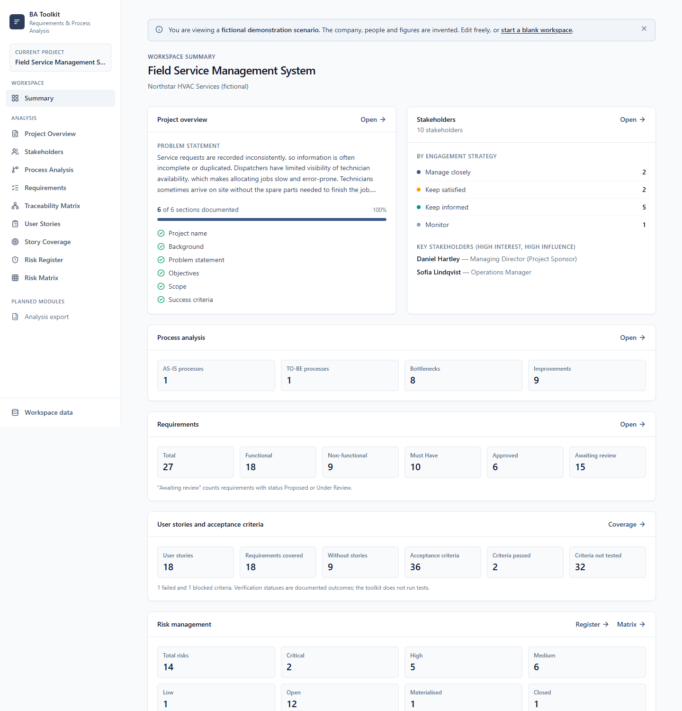
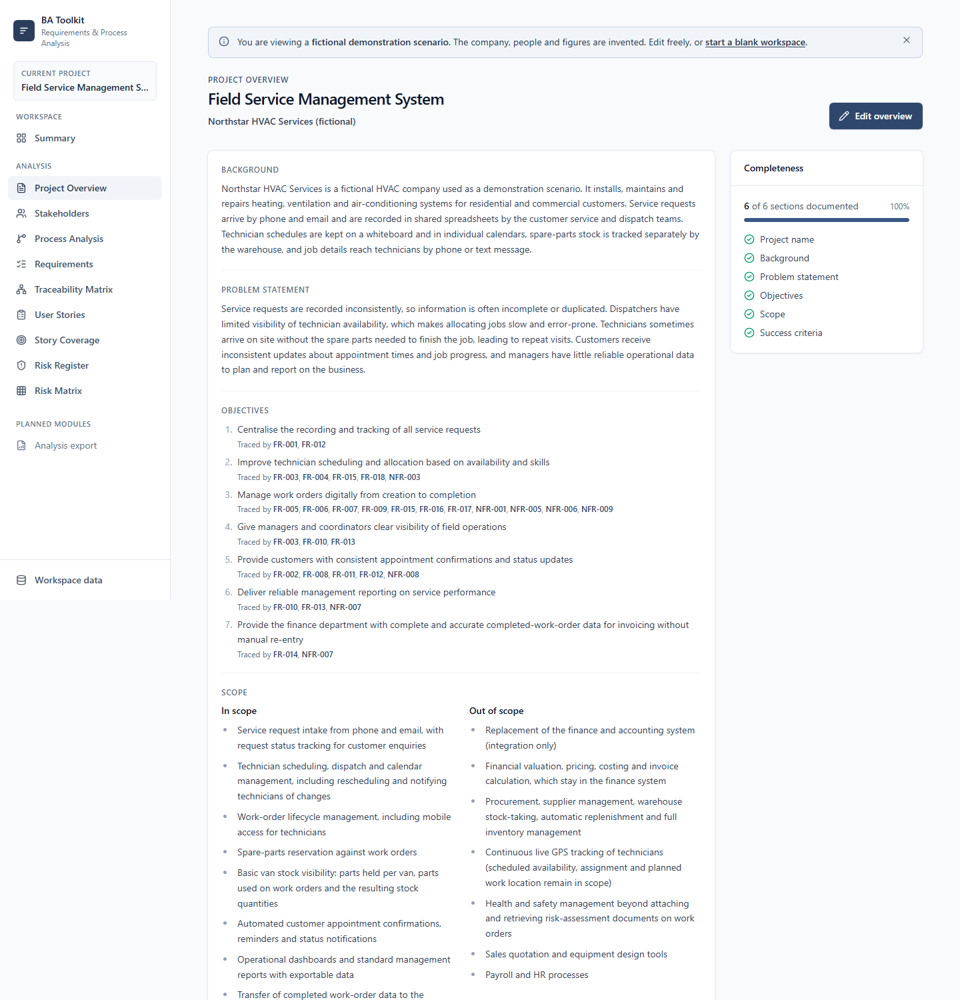
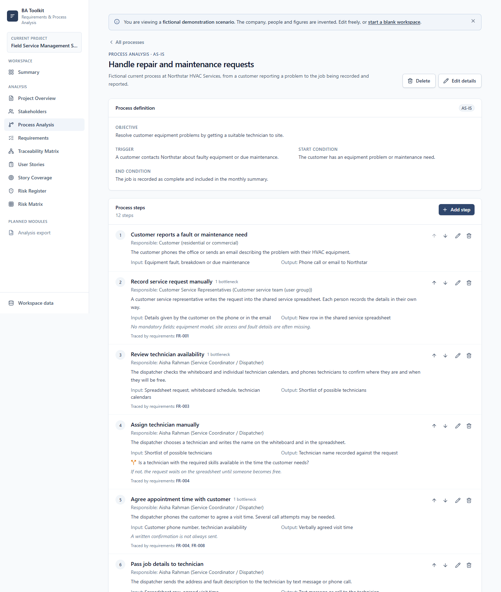
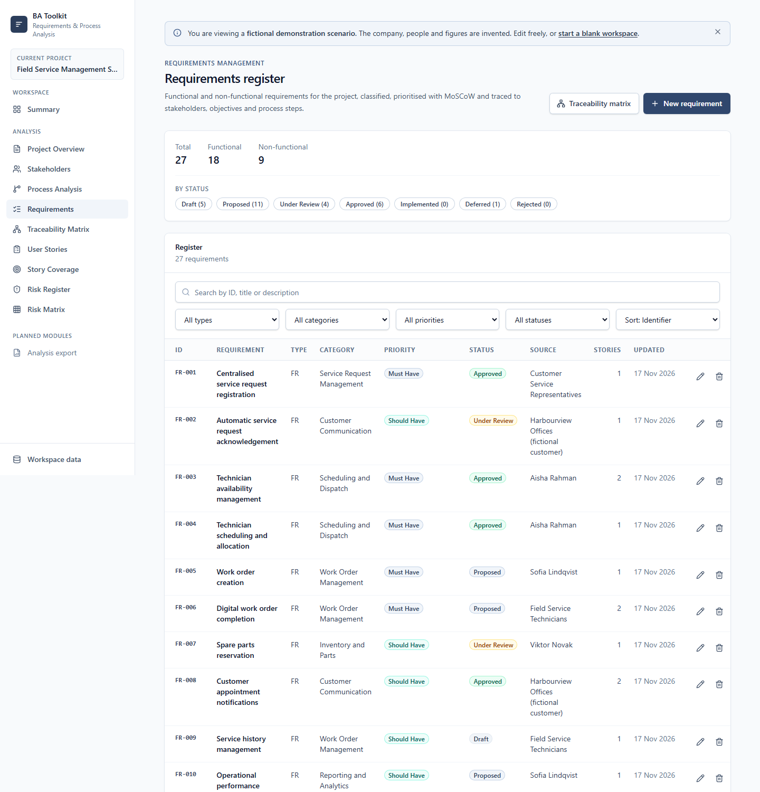
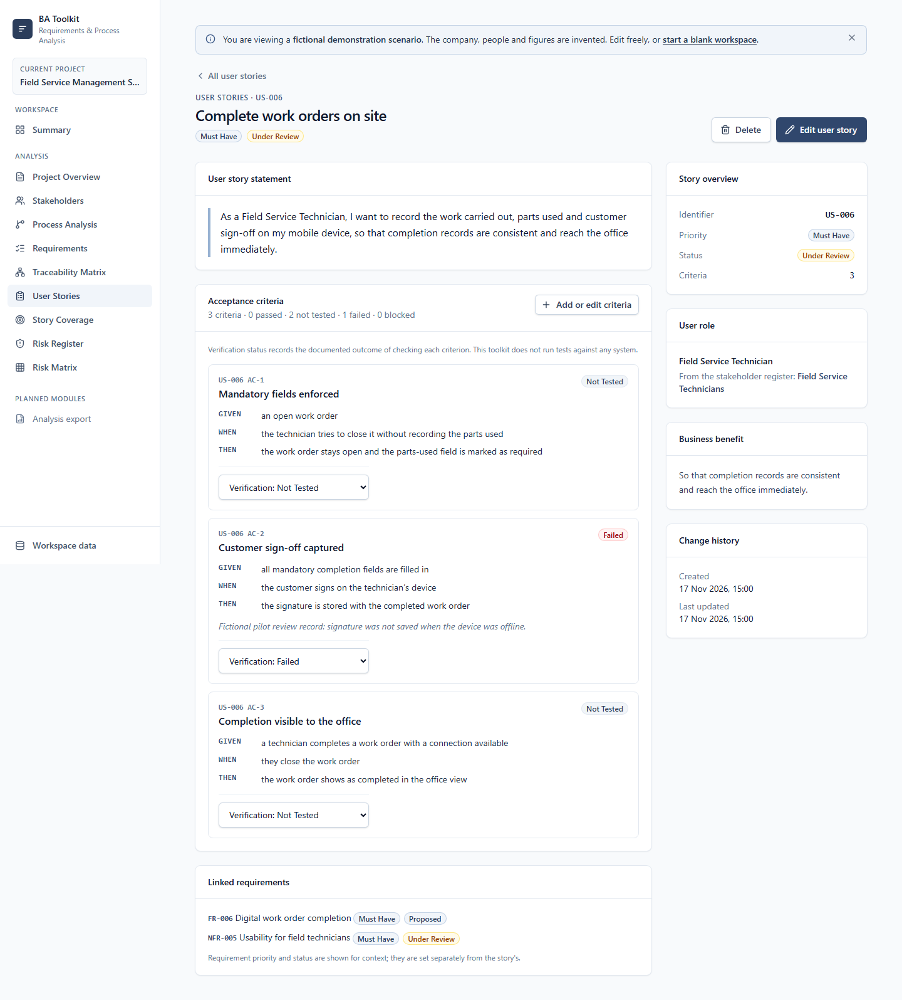
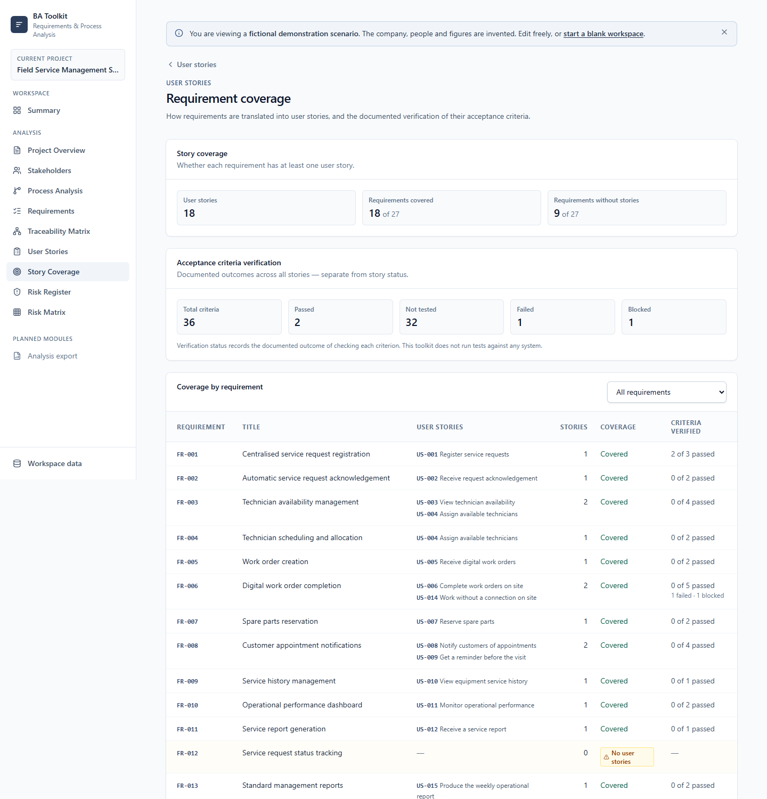

# Business Requirements Toolkit

A browser-based tool for documenting the business analysis behind a planned change: stakeholder analysis, AS-IS and TO-BE processes, requirements with traceability, user stories with acceptance criteria, and risk management, all linked in one workspace.

> **All included data is fictional.** Northstar HVAC Services, its staff, customers, processes, requirements, risks and figures were invented for demonstration. They are not findings from a real organisation or validated stakeholder research, and numeric targets are illustrative planning goals, not measured results. Do not enter real or confidential business data.

## Overview

Northstar HVAC Services, a fictional heating, ventilation and air-conditioning company, coordinates its work with phone calls, emails, spreadsheets and a whiteboard. Requests are recorded inconsistently, dispatchers cannot easily see who is available, technicians arrive without the right parts, customers chase updates by phone and finance re-keys paper job sheets. The company is planning a Field Service Management (FSM) system.

The toolkit documents the analysis for that change. A stakeholder list, process maps, a requirements spreadsheet, user stories and a risk register usually live in separate documents, which makes it hard to see why a requirement exists or what depends on it. Here they are kept in one linked model, so each requirement can be followed from the stakeholder and objective behind it, through the process steps it changes, to the user stories that deliver it and the risks that threaten it. **It is an analysis tool, not an FSM application:** it does not take service requests, dispatch technicians, manage work orders, reserve parts or send notifications.

It is a portfolio project demonstrating business analysis and requirements engineering practice, and it runs locally in the browser with no server or account. The author set the scope, defined the module requirements and acceptance rules for each development phase, reviewed the results and made the project decisions, including the scope decisions D1–D7 in [docs/business-case.md](docs/business-case.md#scope-decisions). The code and tests were written with Claude Code, an AI coding assistant, to those requirements. The demonstration content was drafted with AI assistance and then reviewed and refined by the author.

## Screenshots

All screenshots show the fictional Northstar HVAC demonstration data.

### Workspace and stakeholders

| Workspace summary | Stakeholder analysis |
| --- | --- |
|  |  |

Project charter with background, problem statement, objectives, scope and illustrative success criteria.



### Process analysis

| AS-IS process with bottlenecks | AS-IS and TO-BE comparison |
| --- | --- |
|  |  |

### Requirements and user stories

| Requirements register | Traceability matrix |
| --- | --- |
|  |  |

| User story with acceptance criteria | Story coverage |
| --- | --- |
|  |  |

### Risk management

| Risk register | Risk matrix |
| --- | --- |
|  |  |

## Key features

- **Project overview and stakeholder analysis:** record the project's background, problem statement, objectives, scope and success criteria, with a completeness checklist. Rate each stakeholder's influence and interest; the engagement strategy is calculated from the ratings and shown on an influence-interest grid.
- **Process analysis:** document AS-IS and TO-BE processes as ordered steps with an owner, input, output and decision points. Record bottlenecks against AS-IS steps and improvements against TO-BE steps, mark each TO-BE step as unchanged, modified, new or automated, and compare both processes side by side.
- **Requirements management and traceability:** record functional (`FR`) and non-functional (`NFR`) requirements with category, rationale, MoSCoW priority, status and acceptance criteria. Link each one to a source stakeholder, objectives, process steps and the requirements it depends on (circular dependencies are rejected). A traceability matrix shows every link and filters for gaps.
- **User stories and acceptance criteria:** write stories as "As a … I want … so that …" for a stakeholder or a custom persona, and link them to the requirements they implement. Add Given / When / Then criteria with a recorded outcome (Not Tested, Passed, Failed or Blocked). A coverage view shows which requirements have stories, separately from verification.
- **Risk management:** record each risk's category, probability and impact, response, mitigation and contingency plans, owner and status. Score and severity are calculated, risks are shown on a 5 × 5 matrix, and each risk can be linked to the stakeholders, objectives, steps, requirements and stories it affects.
- **Consistent links:** records that others depend on cannot be deleted until the reference is removed, and identifiers such as `FR-007` or `RSK-003` are never reused.
- **Workspace data:** restore the demonstration data or start a blank workspace. A confirmation lists how many records of each type will be deleted.

## Technology stack

- [React 19](https://react.dev/) with strict [TypeScript 7](https://www.typescriptlang.org/)
- [Vite 8](https://vite.dev/) for the development server and production build
- [React Router 8](https://reactrouter.com/) for routing, with each module loaded when first opened
- [Tailwind CSS 4](https://tailwindcss.com/) for styling and [Lucide](https://lucide.dev/) for icons
- [Vitest 5](https://vitest.dev/) with Testing Library and jsdom for unit tests of the business rules and storage, and integration tests that work through every module
- [oxlint](https://oxc.rs/) for linting, used because ESLint's TypeScript parser does not support the TypeScript 7 native compiler
- Browser `localStorage` for persistence, with no backend

## Getting started

Requires npm and Node.js 22.22.2 or later in the 22.x line, or 24.15 or later in the 24.x line (developed and tested with 24.22). Other major versions, including 23.x and 25.x, are not supported by the test tooling.

```bash
git clone https://github.com/prxtk7/Business-Requirements-Toolkit.git
cd Business-Requirements-Toolkit
npm ci
npm run dev
```

Open the URL that Vite prints, normally <http://localhost:5173/>. The Northstar HVAC demonstration data loads automatically on first start.

| Script | Description |
| --- | --- |
| `npm run dev` | Start the development server with live reload |
| `npm run build` | Type-check, then create a production build in `dist/` |
| `npm run preview` | Serve the production build locally (run `build` first) |
| `npm run typecheck` | Run the TypeScript type check only |
| `npm run lint` | Run oxlint, treating warnings as errors |
| `npm test` | Run the tests once |
| `npm run test:watch` | Run the tests in watch mode |

A hosted copy would need HTTPS (record identifiers use `crypto.randomUUID()`, which requires a secure context) and a rewrite of unknown paths to `index.html`. On Windows, if every test file fails with `Cannot read properties of undefined (reading 'config')`, open the terminal at `C:\…` rather than `c:\…`.

## Business analysis methodology

The modules follow the order in which an analysis is usually built, and each adds records that later ones link back to.

**Stakeholder analysis.** Stakeholders are rated low, medium or high for influence and interest. High on both means *manage closely*; high influence with lower interest means *keep satisfied*; high interest with lower influence, or medium on both, means *keep informed*; the rest are *monitor*.

**AS-IS and TO-BE processes.** The AS-IS process records how work is done today and where it goes wrong (bottlenecks). The TO-BE process records the intended way of working, and each step states how it relates to the current one. In the demo, 1 step is unchanged, 8 are modified, 2 are new and 3 are automated.

**Requirements and MoSCoW.** Functional requirements state what the proposed system must do; non-functional requirements state qualities such as availability, security or usability. Each is prioritised as Must, Should, Could or Won't have (this time). A Won't-have requirement stays in the register so the excluded request remains visible.

**Traceability.** Each requirement should trace to a source stakeholder, an objective, process steps and at least one user story. The matrix reports missing links but never fills them in. In the demo, 23 of 27 requirements are fully traced and 9 have no user story; these gaps are deliberate.

**User stories and acceptance criteria.** Stories split requirements into deliverable pieces of work, and acceptance criteria state the observable conditions for accepting each story. *Coverage* only means a story exists for a requirement. Verification outcomes are recorded by the user; the toolkit does not run tests.

**Risk assessment.** Probability and impact are rated 1–5, and **score = probability × impact** (1–25). A score of 1–4 is Low, 5–9 Medium, 10–16 High and 17–25 Critical. The ratings are the analyst's judgement, so the score is a way to rank risks, not a measurement. Each risk records a response (avoid, mitigate, transfer or accept), mitigation and contingency plans, and an owner.

A worked example that follows spare-parts reservation from stakeholder to acceptance criteria is in [docs/requirements-workflow.md](docs/requirements-workflow.md).

## Data and privacy

- Workspace data is stored in the browser's `localStorage`. It is specific to that browser profile and device, and clearing site data deletes it.
- The app has no backend, accounts or synchronisation, and does not send workspace data to a server.
- Data in `localStorage` is not encrypted, and anyone using the same browser profile can see and change it.
- Saved data is versioned and checked on load. If it is unreadable or needs repair, the original is first copied to a backup key in `localStorage` and a notice explains what happened.
- Restoring the demo or starting a blank workspace permanently replaces the current workspace, with no copy kept.
- The included Northstar HVAC data is fictional. Do not enter real or confidential business data.

## Limitations

- **Analysis only:** the toolkit documents a proposed FSM system; it performs no field-service operations.
- **One project per browser:** there are no accounts, sharing, synchronisation or collaboration, and open tabs do not share changes.
- **No export or import:** there is no PDF, Word, Excel or CSV export and no import from other tools. "Analysis export" appears in the navigation as a planned feature and is not implemented.
- **No history or approvals:** records keep created and updated times only, and statuses such as *Approved* have no sign-off workflow behind them.
- **Step-based processes:** there is no BPMN diagram or notation.
- **Fixed scales:** influence and interest use three levels and risk ratings use 1–5; neither can be configured.
- **Limited testing:** automated tests run in jsdom, and manual checks used Microsoft Edge at desktop and mobile widths. Firefox, Safari, real mobile devices and screen readers have not been tested.
- **Not deployed:** there is no hosted version.

The full list is in [docs/limitations.md](docs/limitations.md).
