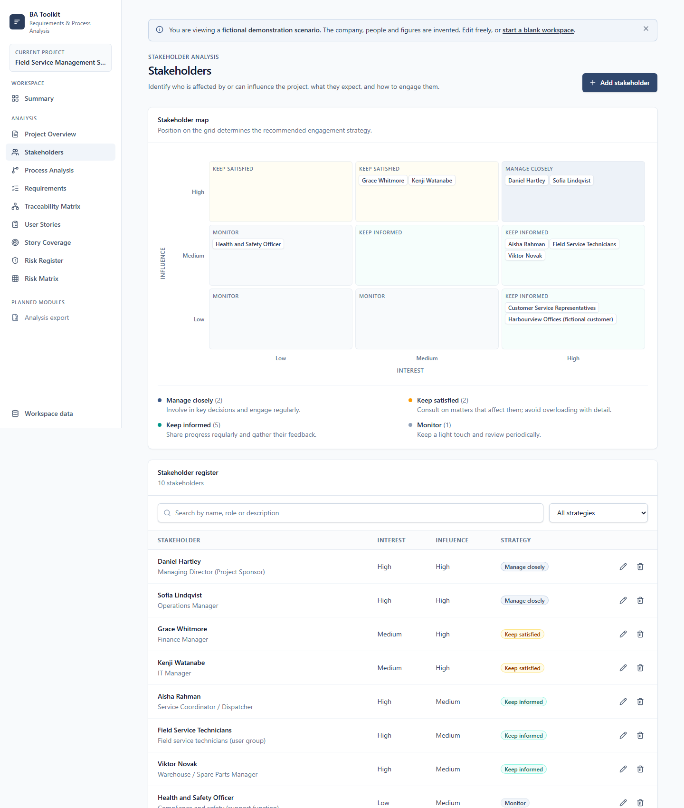
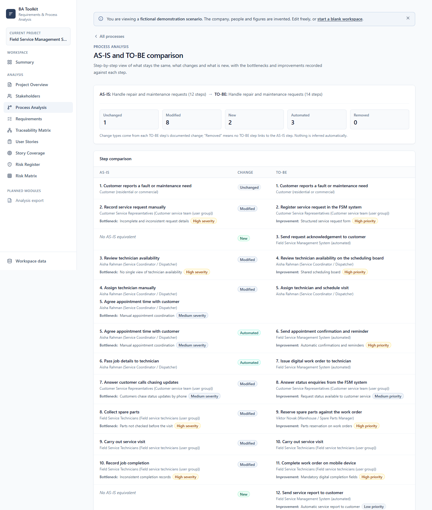
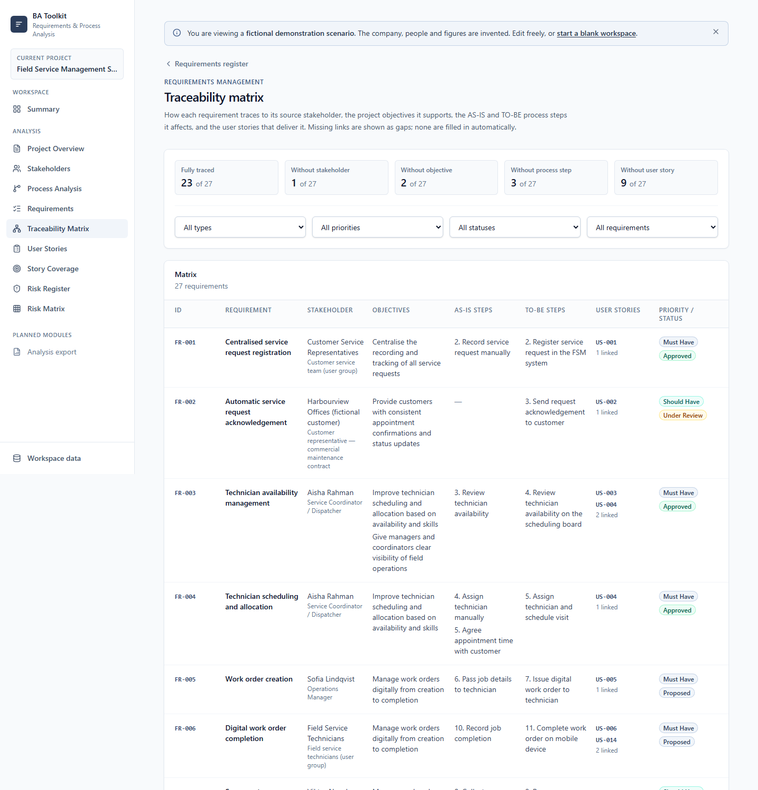
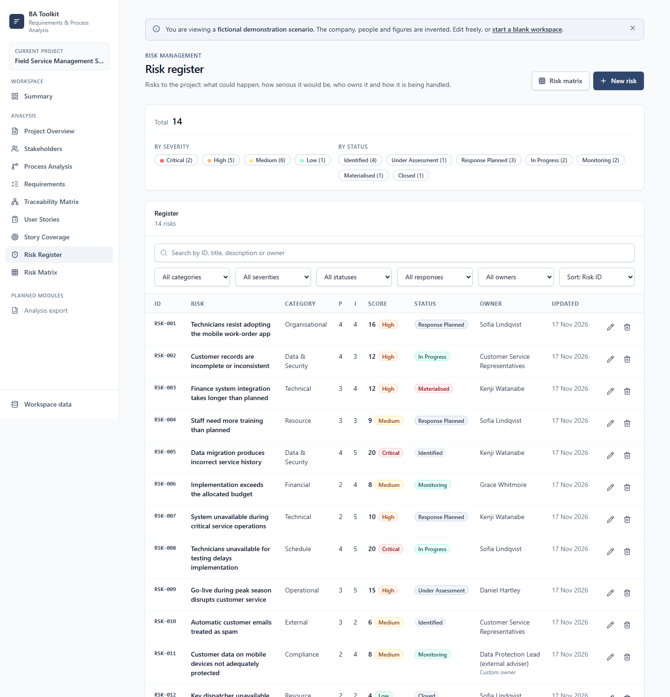
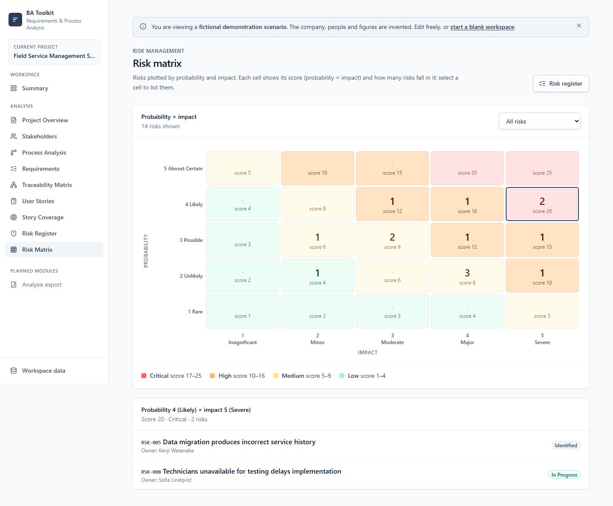

# Business Requirements Toolkit

A browser-based workspace for the analysis behind a business change: project charter, stakeholder analysis, AS-IS and TO-BE process analysis, requirements with traceability, user stories with acceptance criteria, and risk management.

It is demonstrated with a **fictional** case: *Northstar HVAC Services*, an HVAC service company planning a Field Service Management (FSM) system. The toolkit documents and connects the analysis for that system. **It is not an FSM application itself**: it does not dispatch technicians, take service requests, manage stock or execute work orders.


## Contents

- [Overview](#overview)
- [The business problem](#the-business-problem)
- [Project objectives](#project-objectives)
- [Solution and boundaries](#solution-and-boundaries)
- [Modules](#modules)
- [Key capabilities](#key-capabilities)
- [Screenshots](#screenshots)
- [Technology](#technology)
- [Architecture](#architecture)
- [Getting started](#getting-started)
- [Testing and quality](#testing-and-quality)
- [Known limitations](#known-limitations)
- [Possible next steps](#possible-next-steps)
- [About this project](#about-this-project)

## Overview

Business analysis artefacts often live in separate documents: a stakeholder list in one place, process maps in another, requirements in a spreadsheet, stories in a ticketing tool and risks in a register. This toolkit keeps them in one model and links them, so it is possible to answer questions such as:

- Which stakeholder asked for this requirement, and which objective does it serve?
- Which current process problem does it address, and how does the future process change?
- Which user stories deliver it, and have their acceptance criteria been checked?
- Which risks threaten it, how severe are they, and who owns them?

Records are entered through forms with validation. Links are kept consistent: for example, a stakeholder cannot be deleted while a requirement still names them as its source.

## The business problem

> **Fictional scenario.** Northstar HVAC Services and every person, customer, process and figure in the demo are invented. Numeric targets are labelled illustrative; they are planning goals, not results or research findings.

Northstar installs, maintains and repairs heating, ventilation and air-conditioning systems. Service requests arrive by phone and email and are recorded in shared spreadsheets. Technician schedules are kept on a whiteboard and in individual calendars, spare parts are tracked separately, and job details reach technicians by phone or text message. As a result:

- requests are recorded inconsistently and are often incomplete;
- dispatchers cannot easily see which technicians are available;
- technicians sometimes arrive without the parts needed, causing repeat visits;
- customers receive inconsistent appointment and status updates;
- finance re-keys paper job sheets to raise invoices;
- managers have little reliable operational data.

The full scenario is described in [docs/business-case.md](docs/business-case.md).

## Project objectives

The demo project, *Field Service Management System*, records seven objectives:

1. Centralise the recording and tracking of all service requests.
2. Improve technician scheduling and allocation based on availability and skills.
3. Manage work orders digitally from creation to completion.
4. Give managers and coordinators clear visibility of field operations.
5. Provide customers with consistent appointment confirmations and status updates.
6. Deliver reliable management reporting on service performance.
7. Provide the finance department with complete and accurate completed-work-order data for invoicing without manual re-entry.

Objective 7 and several scope boundaries (live GPS tracking excluded, van stock visibility limited to viewing and deducting, health and safety limited to document attachment, financial valuation left in the finance system) were added after a stakeholder and scope review. They are the author's project decisions for the fictional scenario, not findings validated with a real organisation. They are listed in [docs/business-case.md](docs/business-case.md#scope-decisions).

## Solution and boundaries

| | |
| --- | --- |
| **What this toolkit implements** | A structured, linked record of the analysis: charter, stakeholders, processes, requirements, user stories, acceptance criteria and risks, with traceability, coverage and risk views |
| **What the proposed FSM system would do** (described in the analysis, not built) | Service request intake and status tracking, scheduling and dispatch, mobile work orders with technician change notifications, parts reservation and basic van stock visibility, customer notifications, dashboards and standard reports, transfer of completed work orders to the finance system, site risk-assessment documents on work orders |
| **What the demo data shows** | One fictional project with 10 stakeholders, a 12-step AS-IS and a 14-step TO-BE process, 27 requirements (18 functional, 9 non-functional, including one recorded as Won't Have), 18 user stories with 36 acceptance criteria, and 14 risks |

All data stays in the browser. You can edit the demo freely, start a blank workspace, or restore the demo at any time from **Workspace data**.

## Modules

### 1. Project Overview & Stakeholder Analysis

- Project charter: background, problem statement, objectives, in-scope and out-of-scope items, success criteria, with a completeness checklist.
- Stakeholder register with role, description, expectations, interest and influence.
- Influence-interest grid. The engagement strategy (manage closely, keep satisfied, keep informed, monitor) is derived from the two ratings, never typed in.

### 2. Process Analysis

- AS-IS and TO-BE processes as ordered steps with owner, input, output, decision points and notes.
- Bottlenecks recorded against AS-IS steps (with severity) and improvements against TO-BE steps (with priority).
- Each TO-BE step is marked unchanged, modified, new or automated and linked to the AS-IS steps it replaces. A comparison view shows both side by side, including removed steps.

### 3. Requirements Management & Traceability

- Functional (`FR-001`) and non-functional (`NFR-001`) requirements with category, description, rationale, MoSCoW priority, status and requirement-level acceptance criteria.
- Links to a source stakeholder, objectives, AS-IS and TO-BE steps, and other requirements (circular dependencies are rejected).
- Traceability matrix with gap filters: requirements without a stakeholder, objective, process step or user story.

### 4. User Stories & Acceptance Criteria

- Stories built from role, need and benefit, displayed as "As a … I want … so that …". The role is a stakeholder from the register or a clearly marked custom persona.
- Acceptance criteria in Given / When / Then form, with a recorded verification outcome: Not Tested, Passed, Failed or Blocked.
- Coverage view that keeps "a story exists" separate from "its criteria have been verified".

### 5. Risk Management

- Risk register with category, probability and impact (1–5), response (avoid, mitigate, transfer, accept), mitigation and contingency plans, owner and status.
- Score (probability × impact) and severity band (Low 1–4, Medium 5–9, High 10–16, Critical 17–25) are always calculated, never entered.
- 5 × 5 risk matrix; risks can be linked to stakeholders, objectives, process steps, requirements and stories.

## Key capabilities

| Capability | Example from the demo |
| --- | --- |
| End-to-end traceability | FR-007 *Spare parts reservation* traces to the Warehouse Manager, the work-order objective, AS-IS step *Collect spare parts* (bottleneck: parts not checked before the visit) and TO-BE step *Reserve spare parts against the work order*, and is delivered by US-007 |
| Gap analysis | The traceability matrix reports 23 of 27 requirements fully traced and 9 without a user story. The gaps are deliberate in the demo |
| Process change analysis | The comparison counts 1 unchanged, 8 modified, 2 new and 3 automated steps between AS-IS and TO-BE; no AS-IS step is removed |
| Acceptance criteria and verification | US-006 *Complete work orders on site* has three criteria; one is recorded as Failed in a fictional pilot review |
| Risk assessment | RSK-001 *Technicians resist adopting the mobile work-order app*: probability 4 × impact 4 = 16, High; owned by the Operations Manager; linked to FR-006, NFR-005 and US-006 |
| Data integrity | Identifiers are never reused; deletions that would break a link are blocked or explained; saved data is validated, migrated and backed up before any repair |

A step-by-step walkthrough of these links is in [docs/requirements-workflow.md](docs/requirements-workflow.md).

## Screenshots

| | |
| --- | --- |
|  **Stakeholder analysis.** Influence-interest grid and register |  **AS-IS and TO-BE comparison.** Change per step, bottlenecks and improvements |
|  **Traceability matrix.** Requirement to stakeholder, objective, process and story, with gap totals |  **User story.** Given / When / Then criteria with verification outcomes |
|  **Risk register.** Derived scores and severity, owners, responses |  **Risk matrix.** 5 × 5 probability-impact grid |

All eleven screenshots, with descriptions, are listed in [docs/screenshots](docs/screenshots/README.md).

## Technology

| Area | Choice |
| --- | --- |
| Interface | React 19, TypeScript (strict), Tailwind CSS 4, Lucide icons |
| Routing | React Router, with each module loaded on demand |
| Build | Vite |
| Storage | Browser `localStorage`, versioned and validated |
| Testing | Vitest and Testing Library (jsdom) |
| Linting | oxlint (React Hooks, React Refresh, jsx-a11y and TypeScript rules) |

## Architecture

A single-page application with no backend. Business rules live in a plain TypeScript domain layer with no React code. A reducer and a provider apply and save every change, and each module's pages are loaded when first opened.

```
src/domain     business rules, validation, traceability, scoring, integrity checks
src/state      reducer and provider: validate → apply → save
src/storage    versioned localStorage, migrations, backup and recovery
src/features   one folder per module
src/components layout and reusable UI
```

Details are in [docs/architecture.md](docs/architecture.md).

## Getting started

Requirements: **Node.js 22.22.2 or later in the 22.x line, or 24.15 or later in the 24.x line** (developed and tested with Node.js 24.22), and npm. Other major versions, including 23.x and 25.x, are not supported by the test tooling.

Clone or download this repository, then run:

```bash
cd Business-Requirements-Toolkit
npm ci             # install the exact dependency versions from package-lock.json
npm run dev        # start the development server, then open the address it prints
```

On first start the workspace is filled with the fictional demo. Your changes are saved in this browser only.

Other commands:

```bash
npm test           # run the test suite once
npm run typecheck  # TypeScript check
npm run lint       # oxlint
npm run build      # type check and production build into dist/
npm run preview    # serve the production build locally
```

**Hosting:** the app generates record ids with `crypto.randomUUID()`, which browsers only provide in a secure context. `localhost` counts as secure, so `npm run dev` and `npm run preview` work as they are. A hosted copy must be served over HTTPS, and the host must send every unknown path to `index.html` (a single-page-app fallback or rewrite), otherwise links such as `/requirements/req_demo_fr007` return 404 when opened directly.

**Troubleshooting (Windows):** if every test file fails with `Cannot read properties of undefined (reading 'config')`, the terminal's working directory probably uses a lowercase drive letter (`c:\…`). Vitest then loads itself twice. Open the terminal at `C:\…` and run the tests again.

## Testing and quality

- **365 automated tests** cover business rules, storage and schema migration, state changes, and full-application flows through every module (validation, saving, deleting with blocked or cascading links, traceability, coverage, risk scoring, keyboard behaviour).
- TypeScript strict mode, oxlint with accessibility and React rules, and a production build all pass without warnings.
- Accessibility: labelled form fields, error summaries linked to fields, keyboard-operable navigation and dialogs, visible focus, and focusable scroll regions for wide tables. These were checked in tests and in a browser. No formal audit was carried out.
- Responsive layout checked at 1440 px and 390 px wide in Microsoft Edge.

## Known limitations

- One project per workspace; data is stored in one browser only, with no accounts, sharing or sync.
- No export of the analysis (PDF, Excel, CSV) yet. "Analysis export" appears in the navigation as a planned toolkit feature; it is unrelated to the management reports described in the fictional FSM requirements.
- Verification outcomes are recorded by the user; the toolkit does not run tests.
- Processes are step lists, not BPMN diagrams.
- Tested in Chromium (Edge) only; English interface only.

See [docs/limitations.md](docs/limitations.md) for the full list.

## Possible next steps

- Reporting and export: a requirements specification, the traceability matrix and the risk register as PDF or spreadsheet.
- Import of requirements and stories from CSV.
- Change history and simple approval workflow for requirements and stories.
- BPMN-style diagrams generated from the recorded process steps.
- Optional backend for multi-user projects and sharing.

These are ideas, not commitments.

## About this project

- **Author:** Pratheek Nand
- **Purpose:** portfolio project demonstrating business analysis and requirements engineering practice: stakeholder analysis, process analysis, requirements traceability, user stories and acceptance criteria, risk management, and a usable interface designed with accessibility in mind.
- **How it was built:** with AI assistance, in three parts.
  - *Implementation:* the code and tests were written with an AI coding assistant (Claude Code), working to module requirements and acceptance rules set by the author for each development phase.
  - *Demonstration content:* the fictional Northstar HVAC scenario, requirements, user stories, acceptance criteria and risks were drafted with AI assistance, then reviewed and refined by the author.
  - *Decisions:* the author set the scope, reviewed the results of each phase and made the project decisions, including scope decisions D1–D7. These are decisions for a fictional case, not findings validated with a real organisation.
- **Data:** all demonstration content is fictional.
- **License:** [MIT](LICENSE)
